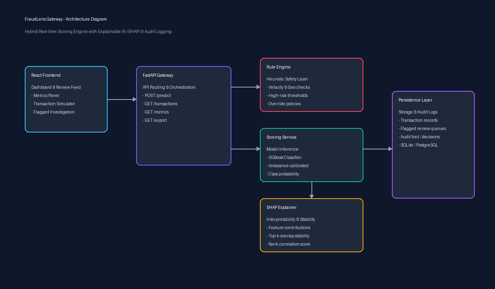

# FraudLens Gateway

[](https://github.com/your-org/fraudlens-gateway/actions/workflows/ci.yml)
[](LICENSE)
[](https://www.python.org/)
[](https://fastapi.tiangolo.com)
[](https://react.dev/)

**FraudLens Gateway** is a production-ready, hybrid transaction scoring gateway designed to prevent payment fraud in real time. It unifies deterministic rule enforcement, calibrated machine learning inference (XGBoost), and Explainable AI (SHAP local attribution) within sub-100ms latency.

---

## System Architecture



```
fraudlens-gateway/
├── .github/
│   └── workflows/
│       └── ci.yml                  # pytest on push, later + lint
├── backend/
│   ├── app/
│   │   ├── main.py                 # FastAPI app entrypoint
│   │   ├── api/
│   │   │   └── routes.py           # /predict, /transactions, /metrics, /export
│   │   ├── core/
│   │   │   └── config.py
│   │   ├── models/
│   │   │   └── schemas.py          # Pydantic request/response models
│   │   ├── services/
│   │   │   ├── scoring.py          # loads model, runs prediction
│   │   │   ├── rules.py            # hybrid rule-based layer
│   │   │   └── shap_explain.py     # SHAP computation + reliability status
│   │   ├── db/
│   │   │   ├── models.py           # SQLAlchemy models (transactions, audit log)
│   │   │   └── session.py
│   │   └── tests/
│   │       └── test_predict.py
│   ├── requirements.txt
│   └── Dockerfile
├── ml/
│   ├── data/
│   │   ├── raw/                    # gitignored — dataset too large for git
│   │   └── processed/              # gitignored
│   ├── notebooks/
│   │   └── eda.ipynb
│   ├── src/
│   │   ├── load_data.py
│   │   ├── preprocess.py
│   │   ├── imbalance_strategies.py # no-resample / class-weight / SMOTE-ENN
│   │   ├── train.py                # trains XGBoost + baselines
│   │   ├── evaluate.py             # Precision/Recall/F1/PR-AUC/MCC
│   │   └── shap_stability.py       # top-k overlap / rank correlation
│   ├── models/                     # saved model artifacts, gitignored (use Git LFS if needed)
│   └── requirements.txt
├── frontend/
│   ├── src/
│   │   ├── components/
│   │   │   ├── TransactionFeed.jsx
│   │   │   ├── FlaggedView.jsx
│   │   │   ├── MetricsPanel.jsx
│   │   │   └── TestTransactionForm.jsx
│   │   ├── pages/
│   │   │   └── Dashboard.jsx
│   │   ├── api/
│   │   │   └── client.js           # fetch/axios wrapper calling backend
│   │   └── App.jsx
│   ├── package.json
│   └── Dockerfile
├── docs/
│   ├── SRS_FraudLens_Gateway.tex
│   ├── proposal.docx
│   └── architecture-diagram.png
├── docker-compose.yml
├── .env.example
├── .gitignore
└── README.md
```

---

## Quick Start

### 1. Run with Docker Compose
The fastest way to spin up both the FastAPI backend and React frontend:
```bash
docker-compose up --build
```
- **FastAPI API & Docs:** [http://localhost:8000/docs](http://localhost:8000/docs)
- **Frontend Dashboard:** [http://localhost:5173](http://localhost:5173)

---

### 2. Manual Local Setup

#### Backend
```bash
cd backend
python -m venv venv
# On Windows:
.\venv\Scripts\activate
# On Linux/macOS:
# source venv/bin/activate

pip install -r requirements.txt
uvicorn app.main:app --reload --port 8000
```

#### Run Backend Tests
```bash
cd backend
pytest -v app/tests/test_predict.py
```

#### Frontend
```bash
cd frontend
npm install
npm run dev
```

---

## Machine Learning Pipeline

The ML pipeline is contained within `ml/` and handles severe class imbalance, model evaluation, and SHAP explanation stability.

```bash
cd ml
pip install -r requirements.txt

# Run training with class-weight or SMOTE-ENN
python src/train.py
```

### Supported Imbalance Strategies
1. **`no-resample`**: Natural distribution baseline.
2. **`class-weight`**: Cost-sensitive weighting (`scale_pos_weight`) inside XGBoost.
3. **`smote-enn`**: Over-sampling minority fraud cases combined with Edited Nearest Neighbor under-sampling.

### Evaluation Metrics
We measure performance via:
- **PR-AUC** (Average Precision) — primary metric under severe class imbalance
- **Recall & Precision** — trade-off optimization
- **MCC** (Matthews Correlation Coefficient)
- **SHAP Stability Index** — top-$k$ Jaccard overlap and Spearman rank correlation across bootstrapped splits.

---

## Core API Endpoints

| Method | Endpoint | Description |
|---|---|---|
| `POST` | `/api/v1/predict` | Score transaction with hybrid rules + ML + local SHAP |
| `GET` | `/api/v1/transactions` | Query historical transactions with optional filtering |
| `GET` | `/api/v1/metrics` | Retrieve aggregated volume, fraud rate, and risk metrics |
| `GET` | `/api/v1/export` | Export audit records in CSV or JSON format |
| `GET` | `/health` | Service health status check |

---

## Documentation
- **Software Requirements Specification (SRS):** [docs/SRS_FraudLens_Gateway.tex](docs/SRS_FraudLens_Gateway.tex)
- **Project Proposal Document:** [docs/proposal.docx](docs/proposal.docx)
- **System Architecture Visual:** [docs/architecture-diagram.png](docs/architecture-diagram.png)

---

## License
Distributed under the MIT License.
